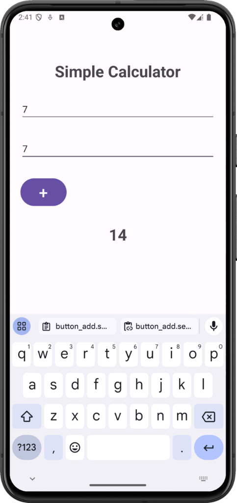

# Unit 2 - Simple Calculator App

Mobile Application Programming — Higher Nitec in AI Applications

A native Android calculator application developed with **Kotlin** and **Android Studio** as part of Unit 2: *Build User Interface for Mobile Devices*.

---

## 📱 App Screenshot

<p align="center">
  
</p>

---

## ✨ Features

- **Responsive Layout:** Structured using `LinearLayout` and `ConstraintLayout` for clean element alignment.
- **Arithmetic Operations:** Supports inputting numbers and performing addition / arithmetic calculations.
- **Dynamic UI Updates:** Displays the calculation results interactively upon tapping the button.
- **Error Handling:** Safe input parsing to prevent crashes when input fields are left blank.

---

## 🛠️ Tech Stack & Requirements

- **Language:** Kotlin
- **UI Framework:** Android XML Views (`LinearLayout`, `TextView`, `EditText`, `Button`)
- **IDE:** Android Studio
- **Minimum SDK:** API 24 (Android 7.0)
- **Target SDK:** API 34+

---

## 🚀 Getting Started

1. **Clone the repository:**
   ```bash
   git clone <YOUR-REPO-URL>
   ```
2. **Open in Android Studio:**
   - Launch Android Studio.
   - Select **Open** and choose the cloned `KotlinCalculatorApp` directory.
3. **Build & Run:**
   - Wait for Gradle sync to complete.
   - Click the green **Run (▶)** button to launch on an Android Emulator or physical device.
